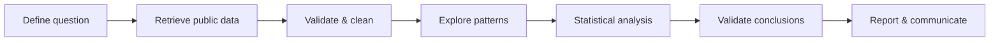

<div align="center">

# PharmaSpend
### Pharmaceutical economics · Spending intelligence

**Real-world data · Reproducible analytics · Industry-focused learning**


[Why this project?](#why-this-project) · [Research questions](#research-questions) · [Learning roadmap](#learning-roadmap) · [Data](#data-source) · [Interview case](#interview-case)

</div>

> [!IMPORTANT]
> **Project stage: planning.** This repository defines a learning and analysis plan, not completed research. No dataset has been acquired or analyzed here yet. We will publish results only after running and verifying the code.

## Why this project?

PharmaSpend investigates how publicly reported U.S. Medicare prescription spending changes over time and how to translate spending and utilization metrics into responsible analytical insights.

**Decision problem:** Which products and utilization patterns contribute most to observed changes in Medicare Part D spending?

## Research questions

1. Which drugs contribute most to changes in aggregate observed spending?
2. How do claims, beneficiaries, and spending per claim change over time?
3. Can we separate utilization effects from changes in spending per unit, subject to the available definitions?
4. Do simple time-series baselines provide useful forecasts for appropriately defined aggregates?

## At a glance

| Dimension | Scope |
|:--|:--|
| Industry | Pharmaceutical economics |
| Source | [CMS — Medicare Part D Spending by Drug](https://data.cms.gov/summary-statistics-on-use-and-payments/medicare-medicaid-spending-by-drug/medicare-part-d-spending-by-drug) |
| Data type | Public, observational records |
| Analytical approach | Descriptive analysis first; statistical modeling only when justified |
| Key outcome | Transparent, reproducible findings—not a performance score alone |
| Current stage | **Planned — no reported results** |

## Analysis workflow



## Learning roadmap

- [ ] **01 · Understand spending variables** — Read CMS definitions, denominators, years, and data limitations
- [ ] **02 · Acquire and audit** — Download an official extract and inspect schema, missingness, identifiers
- [ ] **03 · Data modeling** — Organize records and build SQLite tables with documented keys
- [ ] **04 · SQL analytics** — Write readable JOIN, GROUP BY, and aggregation queries
- [ ] **05 · Explore and explain** — Build spending KPIs and verify derived metrics
- [ ] **06 · Forecast cautiously** — Compare simple temporal baselines when sample size permits
- [ ] **07 · Communicate** — Prepare a business-facing brief with clear denominators

<details>
<summary><strong>📘 What I want to learn</strong> — expand</summary>

- SQL and SQLite schema design
- Aggregations, joins, grouping, time-based comparisons
- pandas data cleaning and reconciliation of totals
- KPI definition, denominator choice, and changes in spending
- Time-series baselines and time-based validation
- Business reporting and responsible interpretation

**Learning rule:** Before adding a method, document what it measures, why it is appropriate, basic assumptions, Python implementation, actual output, and its limitations.

</details>

<details>
<summary><strong>🧪 Validation and reproducibility standards</strong> — expand</summary>

- Keep original source files immutable and document retrieval dates.
- Define the unit of observation, inclusion criteria, and outcome variables.
- Inspect missingness, duplicate records, inconsistent definitions, and potential selection bias.
- Establish a simple baseline before using more complex models.
- Separate training and validation information for any predictive analysis; avoid leakage.
- Record important methodological decisions **before** comparing candidate results.
- Publish reproducible instructions and dependency versions.
- Distinguish association, prediction, and causation.

</details>

## Data source

[CMS — Medicare Part D Spending by Drug](https://data.cms.gov/summary-statistics-on-use-and-payments/medicare-medicaid-spending-by-drug/medicare-part-d-spending-by-drug)

We will document source URLs, access dates, field definitions, terms of use, and any cleaning rules before producing findings. **Do not commit private or sensitive data.**

## Proposed repository layout

```text
PharmaSpend/
├── README.md
├── data/
│   └── README.md                 # provenance and download instructions
├── notebooks/                    # sequential, explainable analyses
├── sql/                          # SQL queries, where appropriate
├── figures/                      # verified exported results
├── results/                      # reproducible outputs
└── docs/
    ├── learning_log.md
    ├── project_decisions.md
    └── glossary.md
```

> This is a **target layout**, not a claim that these directories have already been created.

## Expected deliverables

- [ ] Documented CMS download and data dictionary
- [ ] Working SQLite schema and readable SQL queries
- [ ] Validated spending and utilization indicators
- [ ] Optional baseline forecast only if defensible
- [ ] Executive-style findings report

## Interpretation guardrails

- Medicare Part D is not the entire U.S. pharmaceutical market.
- Spending is not equivalent to manufacturer revenue or profit.
- Changes in coding, drug mix, and utilization can affect comparisons.
- Short annual histories may not support reliable drug-level forecasting.

## Interview case

> **Question a stakeholder might ask:** Why did spending for this therapy category increase over the reporting period?

**What this portfolio should demonstrate:** The ability to reconcile source data, define KPIs, separate utilization from spending-per-unit trends, and recommend sensible follow-up analysis.

<details>
<summary><strong>🎤 Interview preparation checklist</strong> — expand</summary>

- [ ] Explain the business or research decision in one minute.
- [ ] Explain data sources, inclusion criteria, and dataset limitations.
- [ ] Walk through the SQL / Python transformations independently.
- [ ] Explain why the statistical method or model is appropriate.
- [ ] Present verified numerical findings (never placeholders).
- [ ] Describe an alternative explanation and an important limitation.
- [ ] Explain what a stakeholder could reasonably do next.

</details>

---

<div align="center">

**Part of an industry Data Science learning series**

[TrialScope](https://github.com/mbilal-OU/TrialScope) · [PharmaSpend](https://github.com/mbilal-OU/PharmaSpend) · [SafeSignal](https://github.com/mbilal-OU/SafeSignal)

[Research portfolio](https://mbilal-ou.github.io/portfolio/) · [GitHub profile](https://github.com/mbilal-OU)

<sub>Maintained as a transparent learning and research portfolio. Claims and results will be added only after independent verification.</sub>

</div>
