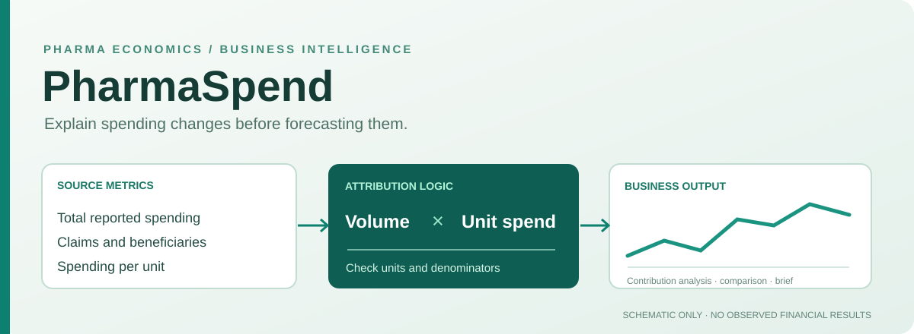
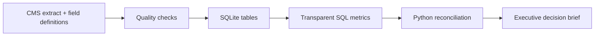

# Pharmaceutical spending, explained

**PharmaSpend** is a planned business analytics case study on how Medicare Part D prescription spending changes—and how analysts should distinguish utilization, spending per unit, and coverage limitations.

[CMS source dataset](https://data.cms.gov/summary-statistics-on-use-and-payments/medicare-medicaid-spending-by-drug/medicare-part-d-spending-by-drug) · [Metric definitions](#metric-design) · [SQL workbench](#sql-workbench) · [Decision brief](#decision-brief)

> [!IMPORTANT]
> **Concept design, not observed spending results.** The schematic above illustrates the analytical logic. The repository is currently in planning; it contains no downloaded CMS data, computed KPIs, or forecasts.

## The business question

> **Which drugs account for observed growth in Medicare Part D spending, and how much of that change is associated with utilization versus spending-per-unit measures?**

This is not a pharmaceutical-sales ranking. A good analyst must carefully define the payer, population, time period, and denominator before making comparisons.

## Metric design

| Planned metric | Why a business team might use it | Interpretation warning |
|---|---|---|
| Total reported spending | Identify large contributors | Not manufacturer revenue |
| Claims | Track dispensing activity | A claim is not a distinct patient |
| Beneficiaries | Examine reported coverage population | Counts require disclosure / suppression review |
| Spending per claim | Contextualize changes | Can shift with product and dosage mix |
| Spending per dosage unit | Explore unit-normalized trends | Only compare where units are compatible |

**Illustrative decomposition:** When the dataset definitions permit a consistent comparison, aggregate spending can be understood in terms of **volume × spending per unit**. We will verify units and product groupings before applying that relationship to CMS fields.

## SQL workbench

The central artifact will be a **documented SQLite dataset**, not just a dashboard screenshot.

<strong>Planned SQL competencies</strong>

- [ ] Define useful keys and column types.
- [ ] Load and validate source extracts.
- [ ] Practice `SELECT`, `WHERE`, `GROUP BY`, and `HAVING`.
- [ ] Join supplementary lookup tables only when keys and licenses are clear.
- [ ] Calculate annual changes and rank contributors.
- [ ] Reconcile queried totals with independent pandas calculations.
- [ ] Explain why a metric's denominator matters.

## Analyst's investigation board

| Stage | Question | Expected evidence |
|---|---|---|
| **Audit** | Are years, drug identifiers, and measured units consistent? | Data dictionary + validation checks |
| **Measure** | Which drugs account for the largest absolute changes? | Reproducible SQL summaries |
| **Explain** | Do utilization or unit-spending patterns dominate? | Decomposition with definitions |
| **Compare** | Are changes concentrated in selected groups? | Distribution and contribution graphics |
| **Forecast?** | Are histories long and consistent enough? | Baseline study—or a documented decision not to forecast |
| **Advise** | What should a stakeholder investigate next? | One-page business interpretation |

### Decision brief

The final product should answer a plausible payer or pharma-analytics request:

> *“Which products contributed most to changing program expenditure, and what drove the change?”*

The report will separate **evidence**, **reasonable interpretation**, and **unresolved questions**. It will not confuse Medicare spending with drug-maker profits or the full U.S. market.

## Source and publication standards

- **Data:** [CMS Medicare Part D Spending by Drug](https://data.cms.gov/summary-statistics-on-use-and-payments/medicare-medicaid-spending-by-drug/medicare-part-d-spending-by-drug).
- **Primary tools:** SQL / SQLite, Python, pandas; visualization added to answer specific questions.
- **Reproducibility:** retrieval date, dictionary, filters, queries, notebook, environment instructions, and verified outputs.
- **Limitations:** aggregation, coding changes, suppression, changing utilization and mix, and short annual time series.

**Progress:** [ ] Source audited · [ ] Database built · [ ] Metrics reconciled · [ ] Insights documented · [ ] Forecasting assessed · [ ] Report finalized

---
**Related work:** [TrialScope](https://github.com/mbilal-OU/TrialScope) explores clinical R&D data · [SafeSignal](https://github.com/mbilal-OU/SafeSignal) explores drug-event reporting.

<a href="https://mbilal-ou.github.io/portfolio/">Research portfolio</a> · <a href="https://github.com/mbilal-OU">GitHub</a>
